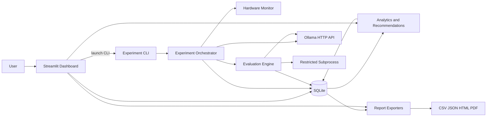
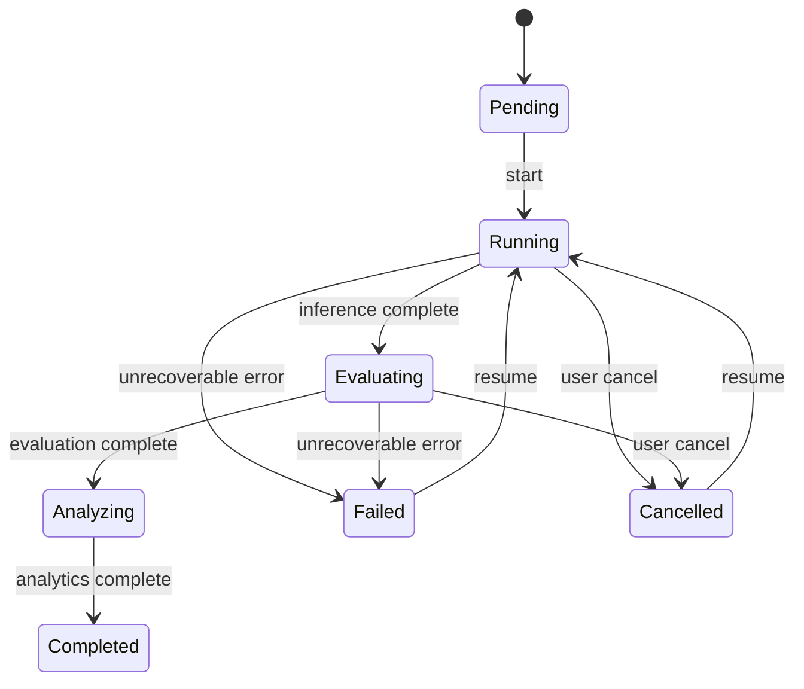
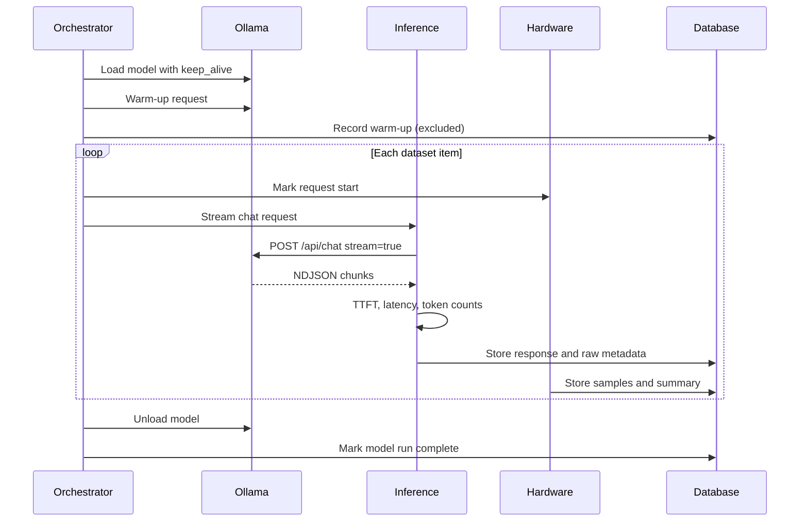
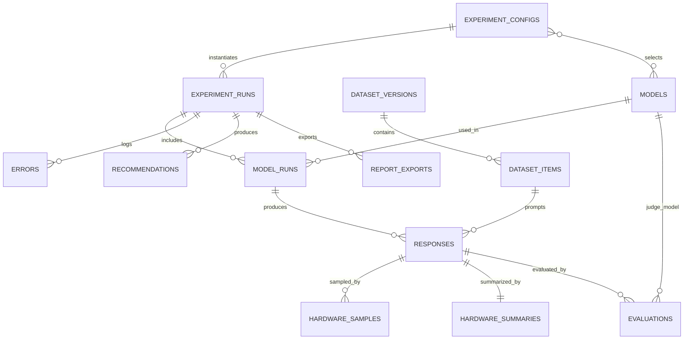

# Architecture — Local LLM Benchmarking and Comparative Evaluation Framework

> **Document purpose:** Describe the planned system architecture, module responsibilities, data flow, storage schema, dependency choices, security boundaries, and phase mapping. This document guides implementation and prevents ad hoc design drift.

| Field | Value |
|---|---|
| Document version | 1.4.0 |
| Status | Phase 07 implemented (pending approval) |
| Date | 2026-11-10 |
| Related documents | `PROJECT_REQUIREMENTS.md`, `EXPERIMENTAL_METHODOLOGY.md`, `METRICS_DEFINITIONS.md`, `DATASET_GUIDE.md` |

---

## 1. Architectural goals

1. **Reproducibility:** every result is traceable to a configuration, dataset hash, model digest, and host snapshot.
2. **Simplicity:** plain Python, direct HTTP calls, SQLite, and a small number of well-known libraries.
3. **Auditability:** raw responses, raw metadata, failures, and hardware samples are preserved.
4. **Sequential correctness:** only one candidate model is measured at a time.
5. **Separation of concerns:** inference, monitoring, evaluation, storage, analytics, and presentation are independent modules.
6. **Honest reporting:** unavailable metrics are represented as missing, never fabricated.
7. **Extensibility:** new models, datasets, evaluators, and workload profiles can be added without rewriting the core.

---

## 2. Constraints

- Windows 11, Python 3.13, local Ollama at `127.0.0.1:11434`.
- NVIDIA GTX 1650 with 4 GB VRAM; partial CPU offload is expected.
- 16 GB system RAM; models run one at a time.
- No Docker, Kubernetes, FastAPI, LangChain, LangGraph, or agent frameworks.
- No remote services or API keys.
- The dashboard must remain responsive during long runs.
- Code execution is best-effort isolated, not a hardened sandbox.

---

## 3. System context



The dashboard is a read-mostly client. Long experiments run in a separate CLI process so the UI event loop is never blocked. The dashboard can start that process and then poll the database for progress.

---

## 4. Repository structure (implemented through Phase 05)

```text
Local LLM Benchmarking and Comparative Evaluation/
├── configs/
│   ├── benchmark.yaml
│   ├── models.yaml
│   └── evaluation.yaml
├── data/
│   ├── datasets/
│   │   ├── benchmark_v1.json
│   │   ├── benchmark_v1.0.0.jsonl
│   │   ├── benchmark_v1.0.0.manifest.json
│   │   ├── probes/
│   │   │   ├── performance_v1.0.0.json
│   │   │   └── consistency_v1.0.0.json
│   │   └── schemas/
│   │       └── benchmark_item.schema.json
│   ├── results/
│   └── exports/
├── docs/
│   ├── PROJECT_REQUIREMENTS.md
│   ├── EXPERIMENTAL_METHODOLOGY.md
│   ├── METRICS_DEFINITIONS.md
│   ├── DATASET_GUIDE.md
│   ├── ARCHITECTURE.md
│   └── DEVELOPMENT_ROADMAP.md
├── scripts/
│   ├── preflight.py
│   ├── pull_models.py
│   ├── validate_dataset.py
│   ├── run_experiment.py
│   └── generate_report.py
├── src/
│   └── benchmark/
│       ├── __init__.py
│       ├── __main__.py
│       ├── core/
│       │   ├── __init__.py
│       │   ├── config.py
│       │   ├── exceptions.py
│       │   ├── health.py
│       │   ├── logging.py
│       │   ├── paths.py
│       │   └── startup.py
│       ├── models/
│       │   ├── __init__.py
│       │   ├── base.py
│       │   ├── hardware.py
│       │   ├── inference.py
│       │   └── ollama.py
│       ├── dataset/
│       │   ├── __init__.py
│       │   ├── loader.py
│       │   ├── models.py
│       │   └── validation.py
│       ├── execution/
│       │   ├── __init__.py
│       │   ├── ollama_client.py
│       │   ├── metadata.py
│       │   ├── registry.py
│       │   ├── engine.py
│       │   ├── streaming.py
│       │   ├── timing.py
│       │   ├── orchestrator.py
│       │   ├── profiles.py
│       │   └── state.py
│       ├── monitoring/
│       │   ├── __init__.py
│       │   ├── system.py
│       │   ├── gpu.py
│       │   ├── sampler.py
│       │   └── summaries.py
│       ├── evaluation/
│       │   ├── __init__.py
│       │   ├── deterministic/
│       │   │   ├── __init__.py
│       │   │   ├── exact.py
│       │   │   ├── numeric.py
│       │   │   ├── code.py
│       │   │   ├── json_schema.py
│       │   │   ├── instructions.py
│       │   │   ├── overlap.py
│       │   │   └── refusal.py
│       │   ├── judge.py
│       │   ├── rubric.py
│       │   ├── sandbox.py
│       │   └── scoring.py
│       ├── database/
│       │   ├── __init__.py
│       │   ├── db.py
│       │   ├── tables.py
│       │   ├── repositories.py
│       │   └── migrations.py
│       ├── analytics/
│       │   ├── __init__.py
│       │   ├── aggregates.py
│       │   ├── normalization.py
│       │   └── recommendations.py
│       ├── reporting/
│       │   ├── __init__.py
│       │   ├── csv_export.py
│       │   ├── json_export.py
│       │   ├── html_report.py
│       │   ├── pdf_report.py
│       │   └── templates/
│       └── dashboard/
│           ├── __init__.py
│           ├── app.py
│           ├── components/
│           └── pages/
│               ├── 01_Overview.py
│               ├── 02_Model_Comparison.py
│               ├── 03_Performance.py
│               ├── 04_Quality.py
│               ├── 05_Hardware.py
│               ├── 06_Response_Inspector.py
│               ├── 07_Experiment_History.py
│               ├── 08_Recommendations.py
│               ├── 09_New_Experiment.py
│               └── 10_Reports.py
├── storage/
│   ├── benchmark.db
│   ├── model_metadata.json
│   └── logs/
├── tests/
│   ├── conftest.py
│   ├── unit/
│   ├── integration/
│   ├── evaluation/
│   └── performance/
├── .env.example
├── .gitignore
├── pyproject.toml
└── README.md
```

Phase 04 adds `src/benchmark/models/inference.py` for response, timing, token, and run-summary schemas; `src/benchmark/execution/streaming.py` for NDJSON chat-chunk parsing; and `src/benchmark/execution/engine.py` for request execution, batch controls, cancellation, and interim JSONL logging. Phase 05 adds `src/benchmark/models/hardware.py` for sample and summary schemas plus `src/benchmark/monitoring/` for system, GPU, summary, and sampler responsibilities. The inference engine attaches a hardware summary and optional hardware error to each response record.

### 4.1 Structure rules

- Files are created only when they have a clear responsibility.
- Trivial evaluators may be consolidated if a file would contain only a few lines, but the evaluator registry and tests must remain clear.
- Generated artifacts (`storage/`, `data/results/`, `data/exports/`) are gitignored; placeholder files keep the empty runtime directories in version control.
- Configuration is data, not code; no secrets are stored.
- Every Python file starts with the required docstring header.

---

## 5. Component responsibilities

### 5.1 Configuration (`benchmark.core.config`)

**Responsibilities:**

- Load YAML files.
- Validate with Pydantic models.
- Resolve paths relative to the project root.
- Compute a canonical configuration hash and expose it as `AppSettings.config_hash`.
- Refuse unknown keys where appropriate.
- Apply safe defaults only when documented.

**Planned configuration files:**

| File | Contents |
|---|---|
| `benchmark.yaml` | Dataset path/version, generation settings, repetitions, timeouts, cooldowns, sampling interval, and runtime output paths |
| `models.yaml` | Ollama base URL, keep-alive value, candidate tags, judge tag, expected digests, and expected quantization |
| `evaluation.yaml` | Judge settings, rubric version, sample rates, reliability settings, and category judge weights |

Workload profile weights are introduced in Phase 08 as an additive section of `benchmark.yaml`; the Phase 01 schema deliberately contains only fields required by the implemented phases.

### 5.2 Ollama client (`benchmark.execution.ollama_client`)

**Responsibilities:**

- Wrap `httpx.Client` with base URL and timeouts.
- Implement `/api/version`, `/api/tags`, `/api/show`, `/api/ps`, `/api/pull`, `/api/chat`, and `/api/generate` lifecycle calls.
- Parse NDJSON streaming responses.
- Raise typed exceptions for connection, HTTP, model, parse, and timeout errors.
- Never hide partial stream failures.
- Allow a pull to be interrupted with `KeyboardInterrupt`; no automatic retry or hidden fallback.

**Design choice:** use `/api/chat` for candidate prompts. Instruction-tuned models are chat models, and Ollama applies their templates. A single user message is sent, with no custom system message by default. The judge uses `/api/chat` with a system message and a user message containing the rubric and delimited response.

**Why not `/api/generate`:** it would bypass the chat template and change model behavior. The chat endpoint is the natural interface for these artifacts.

### 5.3 Model registry and metadata (`benchmark.execution.registry`, `metadata`)

**Responsibilities:**

- Discover installed models.
- Verify candidate and judge availability.
- Pull missing models only with explicit approval.
- Collect tag, digest, size, family, parameter count, quantization, context length, embedding length, capabilities, license, and Ollama version.
- Load and unload models with `/api/ps` confirmation.
- Verify digests and quantization against the configuration.
- Provide a heuristic memory-fit assessment for the 4 GiB VRAM / 16 GiB RAM target; actual placement remains measured data.
- Store a metadata snapshot per experiment, defaulting to `storage/model_metadata.json`.

### 5.4 Dataset (`benchmark.dataset`)

**Responsibilities:**

- Load and validate the canonical 100-item JSON dataset at `data/datasets/benchmark_v1.json`.
- Load the compatibility JSONL export plus its sidecar manifest, and validate both through the same models.
- Load versioned performance and consistency probes.
- Enforce category, difficulty, unanswerable, evaluation-type, unique-ID, and prompt-uniqueness rules.
- Validate every item-defined JSON Schema and its reference JSON document.
- Compute canonical SHA-256 content hashes over sorted item payloads.
- Provide deterministic item ordering with seed 42.
- Refuse to run with an unvalidated or changed dataset.
- Generate the item JSON Schema artifact from the Pydantic model.

**Schema choice:** Pydantic models for dataset items and configuration. JSON Schema validation for item-defined structured outputs uses the `jsonschema` library, because the benchmark needs to validate arbitrary schemas that are not known at code-writing time. The canonical dataset is JSON; the JSONL export is a deterministic compatibility artifact, not the source of truth.

### 5.5 Experiment orchestrator (`benchmark.execution.orchestrator`)

**Responsibilities:**

- Create an immutable configuration snapshot and run record.
- Enforce sequential model execution.
- Manage run types: warm, cold, smoke.
- Manage model order, cooldown, warm-up, and unload.
- Track state transitions: `pending → running → completed`, `failed`, or `cancelled`.
- Resume interrupted runs without duplicating completed responses.
- Persist errors at every stage.
- Trigger evaluation, analytics, recommendations, and reports after inference.

**State machine:**



### 5.6 Inference engine (`benchmark.execution.engine`)

**Responsibilities:**

- Build the request payload with fixed generation options.
- Stream the response.
- Measure TTFT and total latency with a monotonic clock.
- Capture token counts and Ollama durations from the final chunk.
- Record finish reason and status.
- Enforce timeouts.
- Return a structured result object for storage.
- Never retry candidate requests by default.
- Execute selected models and prompts sequentially with warm-up, repeats, and cold-start unload controls.
- Distinguish success, empty, timeout, error, and cancelled outcomes.
- Support cooperative cancellation and graceful keyboard interruption.
- Append interim response records to JSONL until Phase 07 storage exists.
- Use `benchmark.execution.streaming` for NDJSON parsing and `benchmark.execution.timing` for formulas.
- Start and stop the hardware sampler around each measured request, attach a `HardwareSummary`, and record monitoring failures without failing inference.
- Read Ollama model VRAM from `/api/ps` after the request and attach it to the hardware summary when available.

### 5.7 Hardware monitor (`benchmark.monitoring`)

**Responsibilities:**

- Sample CPU, system RAM, Ollama process RSS, GPU utilization, GPU memory utilization, VRAM, and GPU temperature.
- Run a sampler in a background thread with request start/end markers.
- Compute baseline, inference-window, and overall summaries.
- Detect unavailable sensors and mark them with nulls and availability flags.
- Fall back from NVML to `nvidia-smi` where needed.
- Record sampler overhead and matched Ollama process names.
- Read Ollama model VRAM from `/api/ps` after the response and store it separately from system VRAM.
- Keep sampling isolated from inference failures: monitoring errors become `hardware_error`, not failed responses.

**Design choice:** one sampler lifecycle per measured request, started before the baseline window and stopped after the response. This is simpler than a model-run sampler and gives each response its own baseline and inference windows. The trade-off is thread and process-discovery overhead per request; the summary records the measured sampler overhead so this cost is visible.

### 5.8 Evaluation engine (`benchmark.evaluation`)

**Responsibilities:**

- Dispatch each item to its primary deterministic evaluator.
- Execute code tests in a restricted subprocess.
- Validate JSON and schemas.
- Compute reference overlap and refusal checks.
- Run the judge only on eligible responses.
- Parse and validate judge output.
- Store evaluation details and failures.
- Compute item, category, and overall scores.

**Ordering:** candidate inference completes first. The judge model is loaded after all candidate models are unloaded, so judge inference cannot contaminate candidate performance measurements.

### 5.9 Storage (`benchmark.database`)

**Responsibilities:**

- Define SQLAlchemy tables and relationships.
- Create the schema and schema-version record.
- Provide repositories for runs, responses, evaluations, hardware data, errors, and recommendations.
- Enable SQLite WAL mode and foreign-key enforcement.
- Enforce append-only behavior for completed runs.
- Support resumable runs and efficient dashboard queries.

**Design choice:** SQLAlchemy Core/ORM with a small repository layer. No Alembic in the initial version; additive migrations are handled by a schema-version table and explicit migration functions. This avoids an extra dependency for a single-user local application.

### 5.10 Analytics and recommendations (`benchmark.analytics`)

**Responsibilities:**

- Aggregate latency, throughput, quality, reliability, and hardware metrics.
- Normalize metrics across models.
- Apply workload profiles and configurable weights defined in `METRICS_DEFINITIONS.md` section 8.
- Handle missing metrics and failed requests.
- Compute confidence labels.
- Store recommendations with rationale.

### 5.11 Dashboard (`src/benchmark/dashboard/`)

**Responsibilities:**

- Read the database and display the ten required pages.
- Trigger a new experiment by launching the CLI as a subprocess.
- Poll run status and show progress.
- Inspect raw responses and evaluation details.
- Export reports.
- Never run long inference inside the Streamlit process.

**Design choice:** subprocess-based execution avoids Streamlit rerun/threading problems and keeps the experiment alive if the browser closes.

### 5.12 Reporting (`benchmark.reporting`)

**Responsibilities:**

- Export CSV and JSON.
- Render HTML with Jinja2.
- Render PDF with ReportLab.
- Include methodology, hardware, model metadata, metrics, findings, recommendations, and limitations.
- Include failed and missing measurements.
- Store export metadata and file hashes.

### 5.13 CLI scripts (`scripts/`)

| Script | Purpose |
|---|---|
| `preflight.py` | Check Python, dependencies, configuration, runtime directories, disk space, and Ollama connectivity |
| `pull_models.py` | Explicitly pull missing configured models with progress; requires `--yes` |
| `validate_dataset.py` | Validate dataset counts, item schemas, content hash, and probes |
| `run_experiment.py` | Execute a warm, cold, or smoke experiment |
| `generate_report.py` | Export reports for a completed run |

The CLI is the canonical execution interface. The dashboard uses it rather than duplicating orchestration logic.

---

## 6. Data flow

### 6.1 Experiment startup

1. Load and validate YAML configuration.
2. Validate dataset and probes; compute hashes.
3. Query Ollama version and model metadata.
4. Verify digests.
5. Create `experiment_configs` and `experiment_runs` records.
6. Snapshot host metadata: CPU, RAM, GPU, driver, OS, Python, disk, Ollama version.
7. Mark the run `running`.

### 6.2 Warm run



### 6.3 Evaluation and reporting

1. Deterministic evaluators run on stored responses.
2. Judge runs on eligible responses after candidate models are unloaded.
3. Evaluation records and scores are stored.
4. Analytics aggregates are computed and stored or derived on demand.
5. Recommendations are computed and stored.
6. Reports are generated from the database.
7. The run is marked complete.

---

## 7. Database schema overview

Detailed entity requirements are in `PROJECT_REQUIREMENTS.md`. The planned tables are:

| Table | Purpose |
|---|---|
| `models` | Model metadata snapshots, keyed by tag and digest |
| `dataset_versions` | Dataset/probe version, kind, path, hash, item count |
| `dataset_items` | Validated items and probes |
| `experiment_configs` | Immutable configuration snapshot and hash |
| `experiment_config_models` | Selected candidate models and judge model |
| `experiment_runs` | One execution of a configuration |
| `model_runs` | One model's portion of a run |
| `responses` | Prompt-response records, timings, raw metadata, status |
| `hardware_samples` | Periodic samples with phase and availability flags |
| `hardware_summaries` | Per-response peak, average, and baseline summaries |
| `evaluations` | Deterministic and judge evaluation results |
| `errors` | Structured errors by stage |
| `recommendations` | Workload-specific scores and rationale |
| `report_exports` | Export metadata and file hashes |
| `schema_versions` | Database schema version |

### 7.1 Relationship diagram



### 7.2 Key schema rules

- `experiment_configs.config_hash` is unique.
- `models.digest` is stored in full and indexed.
- `dataset_versions.content_hash` is unique per version.
- `responses` has a unique constraint on `(model_run_id, dataset_item_id, repeat_index, profile)`.
- `hardware_samples.response_id` is nullable for baseline samples not yet assigned.
- `evaluations` has a unique constraint on `(response_id, evaluator_name, dimension)`.
- Completed runs are read-only through the application.
- JSON columns store raw Ollama metadata and evaluator details for audit.
- Timestamps are UTC ISO 8601 strings or timezone-aware datetimes.

### 7.3 SQLite settings

- `PRAGMA journal_mode = WAL`.
- `PRAGMA foreign_keys = ON`.
- `PRAGMA busy_timeout = 5000`.
- Single writer (experiment CLI); dashboard readers.
- Database file under `storage/`.

---

## 8. Configuration and secrets

### 8.1 Configuration precedence

1. Defaults defined in Pydantic models.
2. YAML configuration files.
3. Explicit CLI overrides for non-experimental settings only (for example, output directory).
4. No environment variables that silently change experimental settings.

Experimental settings are snapshotted and hashed. Changing a setting creates a new configuration.

### 8.2 Secrets

- No remote API keys are required.
- Ollama is local.
- Logs must not print environment dumps or credentials.
- If future integrations add secrets, use environment variables and never store them in YAML, SQLite, logs, or reports.

---

## 9. Dependency plan

Runtime dependencies (implemented through Phase 05 plus planned later additions):

| Dependency | Purpose | Why not a simpler alternative |
|---|---|---|
| `httpx` | Ollama HTTP and streaming | Required for reliable streaming and timeouts |
| `pydantic` | Config and data validation | Strong typed validation, already required by the stack |
| `PyYAML` | Configuration files | Human-readable configuration |
| `pandas` | Tabular exports and analysis | Standard for CSV and aggregation |
| `numpy` | Percentiles and arrays | Efficient numeric operations |
| `psutil` | CPU, RAM, process metrics | Cross-platform system monitoring |
| `nvidia-ml-py` | NVML GPU metrics via `pynvml` | Direct GPU telemetry; old `pynvml` package is deprecated |
| `SQLAlchemy` | SQLite access | Required by the stack; safer than raw SQL strings |
| `jsonschema` | Validate model-generated JSON against item schemas | Arbitrary schemas are data, not code |
| `streamlit` | Dashboard | Required by the stack |
| `plotly` | Interactive charts | Required by the stack |
| `Jinja2` | HTML report templates | Required by the stack |
| `reportlab` | PDF reports | Required by the stack |

Development dependencies:

| Dependency | Purpose |
|---|---|
| `pytest` | Unit and integration tests |
| `ruff` | Linting and formatting checks |

Not used:

- LangChain, LangGraph, FastAPI, Docker, Kubernetes, Alembic, Celery, Redis.
- `requests` (httpx is used instead).
- The deprecated `pynvml` package (use `nvidia-ml-py`).
- Any remote observability service.

Dependency management: a single `pyproject.toml` with pinned versions and a `dev` optional dependency group. Installation: `python -m pip install -e ".[dev]"`.

Phase 01 installs `pydantic`, `PyYAML`, and `pytest`; Phase 02 adds `httpx`; Phase 03 adds `jsonschema`; Phase 04 adds no new runtime dependencies; Phase 05 adds `psutil` and `nvidia-ml-py`. `nvidia-smi` is an optional system fallback, not a Python dependency. Remaining runtime and development dependencies are added, pinned, and tested in the phases that first use them.

---

## 10. Concurrency and execution model

- One experiment CLI process per run.
- One candidate model loaded at a time.
- One HTTP request in flight at a time.
- Hardware sampler runs in one background thread per measured request.
- Judge runs after candidate inference.
- Dashboard is read-only during a run and polls the database.
- Report generation runs after the run completes.
- Cancellation sets a flag checked between requests; the in-flight request is aborted.

This model deliberately avoids parallel inference. Concurrency would invalidate latency and hardware measurements on a 4 GB GPU.

---

## 11. Error handling and logging

### 11.1 Exception hierarchy

Implemented and planned typed exceptions:

- `BenchmarkError` (base)
- `ConfigurationError`
- `LoggingError`
- `StartupError`
- `DatasetValidationError`
- `OllamaError`
- `OllamaConnectionError`
- `OllamaTimeoutError`
- `OllamaHTTPError`
- `OllamaResponseError`
- `InvalidModelTagError`
- `ModelNotFoundError`
- `ModelNotRegisteredError`
- `ModelRegistrationError`
- `PullApprovalRequiredError`
- `ModelPullError`
- `ModelLifecycleError`
- `ModelDigestMismatchError`
- `ModelQuantizationMismatchError`
- `InferenceError`
- `InferenceTimeoutError`
- `StreamParseError`
- `EmptyResponseError`
- `EvaluationError`
- `SandboxError`
- `JudgeParseError`
- `StorageError`
- `ReportError`

### 11.2 Error policy

- Errors are stored in the `errors` table with stage, class, message, and traceback.
- Candidate request failures are recorded as response statuses, not raised to the top level unless the run cannot continue.
- Model metadata or digest mismatches stop the run before measurement.
- Judge failures are recorded and excluded from judge aggregates.
- Report failures do not delete experiment data.
- No error is silently swallowed.

### 11.3 Logging

- Python `logging` with console and rotating file handlers.
- Log file under `storage/logs/`.
- Include run ID, model run ID, stage, and request ID where applicable.
- Do not log full prompts or responses at INFO level by default; store them in the database and log identifiers.
- Redact environment variables and any accidental secrets.
- Rotation: 10 MB per file, 5 backups.

---

## 12. Security architecture

### 12.1 Trust boundaries

| Boundary | Trust |
|---|---|
| User configuration | Validated, trusted after validation |
| Dataset files | Validated, trusted after validation |
| Ollama API | Local, but responses are untrusted data |
| Model-generated text | Untrusted |
| Model-generated code | Untrusted and potentially malicious |
| Judge output | Untrusted JSON, parsed and validated |
| Dashboard input | Validated before use |

### 12.2 Code execution

- Code tests run in a subprocess, never in the host process.
- Temporary working directory per test run.
- Python isolated mode (`-I`).
- Minimal environment.
- Per-test and total timeouts.
- Output size caps.
- No shell.
- No dataset-supplied shell commands.
- Best-effort isolation only; for untrusted final use, run under a dedicated low-privilege account or VM.
- The limitation is documented in the UI and reports.

### 12.3 Other controls

- Model-generated JSON is validated and never used to configure privileged operations.
- Prompts and responses are stored as text, not executed.
- Judge prompts delimit candidate responses and instruct the judge to treat them as data.
- Exports escape HTML where needed.
- File paths are resolved and checked to stay within the project or configured output directory.

---

## 13. Performance considerations

- Sequential execution avoids VRAM contention.
- `num_ctx = 4096` limits KV-cache growth.
- `num_predict = 512` limits runaway output.
- The performance probe runs first after warm-up, before the long quality pass, to reduce thermal drift in latency measurements.
- Repeated performance prompts use unique nonce prefixes to prevent Ollama prompt-prefix cache reuse from inflating prompt speed.
- Hardware sampling defaults to 1000 ms and is configurable from 250-1000 ms; NVML is preferred over spawning `nvidia-smi` per sample. Sampler overhead is measured per request.
- Streaming avoids buffering large responses before TTFT.
- SQLite WAL allows dashboard reads during writes.
- Raw responses are stored once; derived metrics are computed from stored data.
- Large exports are generated from the database, not held in memory for the whole run.
- Dashboard queries use indexes and limit rows.

---

## 14. Testing architecture

| Level | Scope | Tools |
|---|---|---|
| Unit | Config, dataset validation, metrics formulas, evaluators, scoring, recommendations | pytest, fixtures |
| Integration | Ollama client against a mock HTTP transport; database repositories against a temporary SQLite file; sampler with fake sensors | pytest, `httpx.MockTransport` |
| End-to-end (optional) | Real Ollama with the judge model or a tiny model, smoke profile only | pytest marker `ollama` |
| Manual | Dashboard pages, report rendering, actual model runs | Checklist in phase reports |

Rules:

- Tests never pull models automatically.
- Tests never require network access.
- Test fixtures are synthetic and clearly labeled; they are not benchmark results.
- Judge tests use recorded or synthetic judge outputs.
- Hardware tests inject fake NVML/psutil values, including unavailable cases.
- Every phase runs `python -m compileall src`, import checks, and `python -m pytest -q`.

---

## 15. Phase mapping

| Phase | Architecture work |
|---|---|
| 00 | Requirements, methodology, metrics, architecture, roadmap |
| 01 | Repository skeleton, configuration, dependency environment, logging, error types |
| 02 | Ollama client, model registry, metadata, pull workflow |
| 03 | Dataset models, loader, validation, probes, hash |
| 04 | Inference engine, streaming, timing, response records |
| 05 | Hardware sampler, NVML/nvidia-smi, Ollama model VRAM, summaries |
| 06 | Deterministic evaluators, sandbox, judge, scoring |
| 07 | SQLAlchemy tables, repositories, orchestrator, resumability |
| 08 | Aggregates, normalization, recommendations |
| 09 | Streamlit dashboard pages |
| 10 | CSV/JSON/HTML/PDF exporters |
| 11 | Test suite, integration, reliability validation |
| 12 | Final experiments, analysis, documentation |

---

## 16. Key architecture decisions

| Decision | Rationale | Trade-off |
|---|---|---|
| Direct Ollama HTTP API | Simple, transparent, no framework lock-in | More manual parsing and error handling |
| `/api/chat` for candidates | Uses instruction-tuned chat templates | Model templates differ; documented |
| No custom system prompt | Preserves artifacts as distributed | Less control over style |
| Streaming required | Enables TTFT | More complex parsing |
| Sequential execution | Valid measurements on constrained hardware | Long run time |
| Separate warm and cold runs | Avoids mixing load time with steady-state metrics | More runs |
| SQLite + SQLAlchemy | Local, simple, reliable, no server | Single-writer limitations |
| Append-only results | Auditability and reproducibility | Storage grows; no in-place correction |
| Deterministic evaluation first | Objective, reproducible scores | Limited to machine-checkable properties |
| Separate judge model | Avoids using candidates to judge themselves | Extra model and bias risk |
| Judge after candidate inference | Avoids resource contention | Delays results |
| Dashboard launches CLI | Keeps UI responsive and runs survive browser closure | Process management complexity |
| Best-effort subprocess sandbox | Practical on Windows without Docker | Not a security boundary |
| Pydantic + YAML | Typed, readable configuration | Schema maintenance |
| No Alembic initially | One local database, simple migrations | Manual migration discipline required |

---

## 17. Known architectural limitations

- Single-user, single-machine design.
- SQLite is not suitable for concurrent writers or large multi-user deployments.
- The dashboard is not a hardened web application and should bind to localhost only.
- The code sandbox is not a security boundary.
- Hardware telemetry on Windows WDDM is incomplete.
- Model templates and Ollama behavior can change between versions; digests and versions are recorded.
- The design does not support distributed or parallel model execution.
- ReportLab PDF layout is less flexible than HTML; PDFs are a secondary format.
- No formal statistical engine is included; analytics are descriptive and exploratory.

---

## 18. What this architecture deliberately does not include

- An agent framework or tool-calling loop.
- A REST API server.
- A message queue.
- A container orchestration layer.
- A cloud database.
- A model training pipeline.
- A prompt-optimization framework.
- A universal leaderboard.

These omissions are intentional. The project is a local benchmarking instrument, not a general AI platform.
