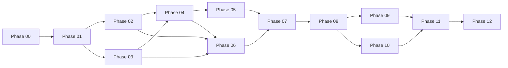

# Development Roadmap — Local LLM Benchmarking and Comparative Evaluation Framework

> **Document purpose:** Define the phase-by-phase implementation plan, deliverables, dependencies, acceptance criteria, and quality gates. This document keeps development incremental and prevents later phases from silently breaking earlier work.

| Field | Value |
|---|---|
| Document version | 1.2.0 |
| Status | Phase 00 complete; Phase 01 complete; Phase 02 complete; Phase 03 complete (pending approval); Phase 04 complete (pending approval) |
| Date | 2026-11-10 |
| Related documents | `PROJECT_REQUIREMENTS.md`, `EXPERIMENTAL_METHODOLOGY.md`, `METRICS_DEFINITIONS.md`, `ARCHITECTURE.md`, `DATASET_GUIDE.md` |

---

## 1. Development principles

- One phase at a time, only when explicitly requested.
- Each phase follows the same workflow: understand, inspect, plan, implement, test, full project scan, report, stop.
- No phase is considered complete until its tests actually run and pass.
- No fabricated test results or benchmark results.
- Existing work is inspected before modification.
- Every Python file begins with the required module docstring.
- Dependencies are added only with a documented reason.
- Historical experiment data is never overwritten.
- The application must remain runnable after every phase, even if some features are not yet implemented.

---

## 2. Status legend

| Status | Meaning |
|---|---|
| Complete | Implemented, tested, scanned, and reported |
| In progress | Currently being implemented |
| Planned | Not started |
| Blocked | Waiting on a decision, dependency, or user approval |

---

## 3. Phase overview

| Phase | Name | Status | Main output |
|---|---|---|---|
| 00 | Requirements and experimental design | Complete | Five baseline documents |
| 01 | Project structure and environment setup | Complete | Installable skeleton, config, logging, preflight |
| 02 | Model setup and metadata collection | Complete | Ollama client, registry, metadata, pull workflow |
| 03 | Benchmark dataset development | Complete (pending approval) | Validated 100-item dataset and probes |
| 04 | Inference engine development | Complete (pending approval) | Streaming inference with timing |
| 05 | Hardware monitoring engine | Planned | CPU/RAM/GPU/VRAM sampler and summaries |
| 06 | Evaluation engine development | Planned | Deterministic evaluators, sandbox, judge, scoring |
| 07 | Database and experiment management | Planned | SQLite schema, repositories, orchestrator, resume |
| 08 | Analytics and recommendation engine | Planned | Aggregates, normalization, workload profiles |
| 09 | Interactive Streamlit dashboard | Planned | Ten dashboard pages |
| 10 | Automated reporting and exports | Planned | CSV, JSON, HTML, PDF |
| 11 | Testing, integration, reliability validation | Planned | Full test suite and reliability checks |
| 12 | Final experiments and documentation | Planned | Real results, analysis, final reports |

---

## 4. Cross-phase quality gates

Every phase must satisfy all gates before it is reported complete.

### 4.1 Required checks

```powershell
python -m compileall src
python -c "import benchmark"
python -m pytest -q
```

If the phase adds scripts or dashboard pages, also run the relevant import or startup check.

If linting is configured:

```powershell
python -m ruff check .
python -m ruff format --check .
```

### 4.2 Full project scan checklist

1. Folder and file structure.
2. Imports and module dependencies.
3. Function and class interfaces.
4. Pydantic schemas.
5. Configuration references.
6. Environment variables.
7. Dependency versions.
8. Database compatibility.
9. Duplicate code.
10. Naming consistency.
11. Error handling.
12. Logging.
13. Existing tests.
14. Integration with previous phases.
15. Potential security problems.

### 4.3 Phase completion report

Each phase report includes:

- What was implemented.
- Files created.
- Files modified.
- Dependencies added.
- Architecture decisions.
- Tests executed.
- Tests passed.
- Tests failed.
- Known limitations.
- Manual tests the user must perform.
- Acceptance criteria status.
- What is still incomplete.

Then the phase stops. The next phase begins only after explicit approval.

---

## 5. Phase 00 — Requirements and experimental design

**Status:** Complete pending user approval.

### Objective

Finalize requirements, methodology, metrics, architecture, and roadmap before writing application code.

### Deliverables

- `docs/PROJECT_REQUIREMENTS.md`
- `docs/EXPERIMENTAL_METHODOLOGY.md`
- `docs/METRICS_DEFINITIONS.md`
- `docs/ARCHITECTURE.md`
- `docs/DEVELOPMENT_ROADMAP.md`

### Acceptance criteria

- Requirements cover all functional areas A–I.
- Methodology defines models, dataset, settings, repetitions, cold/warm separation, judge rubric, and bias mitigation.
- Metrics document formulas and sources.
- Architecture defines components, data flow, schema overview, dependencies, and security.
- Roadmap defines phases 01–12 with acceptance criteria.
- Environment baseline is verified, not assumed.
- Full project scan is performed.
- No application implementation is included.

---

## 6. Phase 01 — Project structure and environment setup

### Objective

Create the installable project skeleton, configuration system, logging, error types, and preflight checks. No model inference yet.

### Inputs

- Phase 00 documents.
- Verified Python and Ollama versions.

### Deliverables

- `pyproject.toml` with pinned runtime and dev dependencies.
- `.gitignore` and `.env.example`.
- `README.md` with setup instructions.
- `configs/benchmark.yaml`, `configs/models.yaml`, and `configs/evaluation.yaml`.
- `src/benchmark/__init__.py` and `src/benchmark/__main__.py`.
- `src/benchmark/core/`: `config.py`, `exceptions.py`, `health.py`, `logging.py`, `paths.py`, and `startup.py`.
- `src/benchmark/models/base.py`.
- Empty package markers for later-phase packages.
- `scripts/preflight.py`.
- Unit tests for configuration, logging, and the shared schema.
- Integration tests for initialization, health checks, and the CLI.
- Package import check.

### Key decisions to implement

- Pydantic models for every configuration section.
- Canonical configuration hash over experimental settings.
- Path resolution relative to the project root.
- UTC timestamps and UTF-8 files.
- Rotating file logging under `storage/logs/`.
- Typed exception hierarchy.
- `python -m benchmark init` and `python -m benchmark health` as the Phase 01 command surface.

### Acceptance criteria

- `python -m pip install -e ".[dev]"` succeeds.
- `python -c "import benchmark"` succeeds.
- `python -m benchmark init` creates runtime directories and logging.
- `python -m benchmark health` reports Python, dependencies, configuration, runtime directories, dataset availability, and (from Phase 02) Ollama connectivity without pulling models.
- `python scripts/preflight.py` invokes the same health check.
- Config files validate; invalid configs fail with clear errors.
- `python -m compileall src` passes.
- `python -m pytest -q` passes.
- Full project scan performed.

### Dependencies

- Phase 00.

### Risks

- Python 3.13 package compatibility.
- Pinned versions unavailable or conflicting.
- Overly complex configuration schema.

### Mitigation

- Verify installed versions before pinning.
- Keep configuration minimal and documented.
- Add fields only when a phase needs them.

---

## 7. Phase 02 — Model setup and metadata collection

### Objective

Implement direct Ollama API access, model discovery, metadata collection, digest verification, explicit pulls, and load/unload operations.

### Inputs

- Phase 01 configuration and error types.
- Installed `llama3.1:8b` and `qwen2.5:3b`.
- Missing `qwen2.5:7b-instruct` and `mistral:7b-instruct-v0.3-q4_K_M`.

### Deliverables

- `src/benchmark/execution/ollama_client.py`.
- `src/benchmark/execution/metadata.py`.
- `src/benchmark/execution/registry.py`.
- `scripts/pull_models.py`.
- Unit tests with `httpx.MockTransport`.
- Optional live metadata check for installed models.

### Key decisions implemented

- `/api/version`, `/api/tags`, `/api/show`, `/api/ps`, `/api/pull`, `/api/chat`, and `/api/generate` lifecycle calls.
- Full manifest digest capture.
- Explicit user confirmation for pulls through `--yes`.
- Digest and quantization comparison with typed mismatch errors.
- Load/unload helpers with `/api/ps` confirmation.
- Metadata snapshot structure at `storage/model_metadata.json` by default.
- `models` CLI commands and the `scripts/pull_models.py` wrapper.
- Heuristic memory-fit assessment for the 4 GiB VRAM / 16 GiB RAM target; actual layer placement remains measured data.

### Acceptance criteria

- Discover installed models and display their metadata.
- Verify `llama3.1:8b` and `qwen2.5:3b`.
- Refuse to pull without explicit confirmation.
- Pull `qwen2.5:7b-instruct` and `mistral:7b-instruct-v0.3-q4_K_M` only when the user approves.
- After pull, record quantization, parameters, context length, size, and digest.
- Handle Ollama offline and missing model errors cleanly.
- Tests pass without network access.
- Full project scan performed.

### Implementation status

- Completed: HTTP client, model discovery, metadata extraction, digest/quantization verification, load/unload confirmation, short inference test, snapshot writer, CLI, script, and tests.
- Verified live: `llama3.1:8b` and `qwen2.5:3b` metadata, digest, load/unload, `/api/ps` state, and short chat inference.
- Verified live: missing models are reported as missing and a pull without `--yes` is refused.
- Deferred: pulling `qwen2.5:7b-instruct` and `mistral:7b-instruct-v0.3-q4_K_M` until the user explicitly approves. Their local digests, quantization, parameter count, and context length remain unverified.

### Dependencies

- Phase 01.

### Risks

- Registry metadata differs from the local artifact.
- Pull size and disk space.
- Ollama version behavior changes.
- Long pull time.

### Mitigation

- Verify with `/api/show` after pull.
- Check disk space in preflight.
- Record Ollama version and digests.
- Show progress and allow cancellation.

---

## 8. Phase 03 — Benchmark dataset development

### Objective

Author, validate, and version the 100-item benchmark dataset and the performance/consistency probes.

### Inputs

- Category and evaluation requirements from Phase 00.
- Dataset schema design.

### Deliverables

- `data/datasets/benchmark_v1.json` (canonical dataset).
- `data/datasets/benchmark_v1.0.0.jsonl` and `benchmark_v1.0.0.manifest.json` (compatibility export).
- `data/datasets/probes/performance_v1.0.0.json`.
- `data/datasets/probes/consistency_v1.0.0.json`.
- `data/datasets/schemas/benchmark_item.schema.json`.
- `src/benchmark/dataset/models.py`, `loader.py`, `validation.py`.
- `scripts/validate_dataset.py`.
- `docs/DATASET_GUIDE.md`.
- Dataset unit and integration tests.

### Key decisions implemented

- Exactly 100 items with the required category counts.
- Six unanswerable items embedded in existing categories.
- Difficulty distribution: 30 easy, 47 medium, 23 hard.
- Stable category-prefixed item IDs.
- Item-level evaluation configurations and accepted-answer alternatives.
- Canonical SHA-256 content hash over sorted item payloads.
- Deterministic ordering with seed 42.
- Canonical JSON source of truth with deterministic JSONL compatibility export.
- No answer leakage and original content only.

### Acceptance criteria

- Exactly 100 quality items.
- Category counts: 15, 15, 15, 15, 15, 15, 10.
- Six unanswerable items with the planned distribution.
- Every item has an expected answer or reference and an evaluation method.
- Coding items include function signatures and tests.
- JSON items include schemas.
- Summarization items include source text and key facts.
- Loader rejects duplicate IDs, missing fields, unknown categories, invalid evaluation methods, hash mismatches, and invalid item JSON Schemas.
- Hash is stable and stored.
- Probes are versioned and validated.
- Tests pass.
- Full project scan performed.

### Implementation status

- Completed: dataset/probe models, canonical JSON and JSONL loading, hash verification, item JSON Schema validation, validation summaries, generated schema, validation CLI, documentation, and tests.
- Verified: 100 items; 30/47/23 difficulty; 6 unanswerable items; 9 performance prompts; 10 consistency items; all 58 coding test cases pass against reference solutions; all 32 instruction-constraint checks pass against reference answers.
- Validation: `scripts/validate_dataset.py` reports `Status: VALID`; canonical JSON and JSONL exports produce the same 100 IDs and SHA-256 `ceafe917235213c710da9e3b6a1ceecb86ba519b214581f683191c51358e46f1`.
- Full project scan: `compileall` passed; full suite `93 passed, 1 skipped`; health passed with the expected warning for the two missing candidate models.
- Pending: user approval of Phase 03 and Phase 04.

### Dependencies

- Phase 01.

### Risks

- Ambiguous prompts.
- Answer leakage.
- Training-data contamination.
- Unbalanced difficulty.
- Dataset authoring time.

### Mitigation

- Manual review checklist.
- Keep prompts self-contained.
- Record contamination risk.
- Report actual difficulty distribution.
- Validate before use.

---

## 9. Phase 04 — Inference engine development

### Objective

Implement streaming inference with client-side timing, Ollama metadata capture, timeouts, cancellation, and structured response records.

### Inputs

- Phase 02 Ollama client.
- Phase 03 dataset items.
- Phase 01 configuration.

### Deliverables

- `src/benchmark/execution/engine.py`, `streaming.py`, `timing.py`.
- Response record model.
- Interim JSONL response log (until Phase 07 database).
- Unit tests with mock streaming responses.
- Optional live smoke test with an installed model.

### Key decisions to implement

- `/api/chat` with one user message.
- Streaming NDJSON parsing.
- First non-empty content chunk for TTFT.
- Final `done = true` chunk for total latency and metadata.
- Fixed generation options.
- 300-second request timeout.
- No automatic retries for candidate requests.
- Cancellation flag.
- Store raw final metadata.

### Acceptance criteria

- TTFT and total latency measured with a monotonic clock.
- Token counts and durations captured.
- Prompt and output tokens per second calculated.
- Timeouts recorded distinctly from other failures.
- Malformed streams produce a typed error.
- Warm-up responses are marked and excluded.
- Tests cover normal, empty, malformed, timeout, and cancellation cases.
- Full project scan performed.

### Implementation status (2026-11-10)

- Implemented in `src/benchmark/execution/engine.py`, `streaming.py`, and `timing.py`; response schemas live in `src/benchmark/models/inference.py`.
- `benchmark infer` supports model and item selection, repeats, warm-up, cold start, output caps, cooldowns, cancellation, `--json`, and interim JSONL logs.
- Unit and CLI tests cover success, empty responses, malformed streams, timeout mapping, cancellation, warm-up exclusion, cold-start ordering, and sequential execution.
- Full suite: 117 passed, 1 skipped. The skip is the opt-in live Ollama integration test.
- Live smoke used installed candidate `llama3.1:8b` with five dataset items and one warm-up. Experiment `20261110T052647Z-afd1e4d4` produced six records, all `success`/`stop`; output is `data/results/inference_20261110T052647Z-afd1e4d4.jsonl`.
- Measured TTFT ranged from 0.173s to 1.485s and total latency from 5.251s to 17.588s for the five-question smoke. These are smoke measurements, not a three-model comparison.
- An earlier 128-token smoke (`20261110T052432Z-2bf63c08`) was superseded because `json-002` reached the output cap.

### Dependencies

- Phases 01-03.

### Risks

- Streaming chunk semantics differ across Ollama versions.
- Empty initial chunks confuse TTFT.
- Interim JSONL duplicates later database records.
- Long CPU-offloaded requests.

### Mitigation

- Record raw chunks in tests.
- Ignore empty content for TTFT.
- Define a stable interim record schema and import it once in Phase 07.
- Use generous timeouts and explicit cancellation.

---

## 10. Phase 05 — Hardware monitoring engine

### Objective

Implement periodic CPU, RAM, Ollama process, GPU, VRAM, and temperature sampling with baseline/inference windows and honest availability flags.

### Inputs

- Phase 04 inference request lifecycle.
- `psutil`, `nvidia-ml-py`, `nvidia-smi` fallback.

### Deliverables

- `src/benchmark/monitoring/system.py`, `gpu.py`, `sampler.py`, `summaries.py`.
- Hardware sample and summary models.
- Tests with fake sensors and unavailable cases.
- Live hardware check.

### Key decisions to implement

- 500 ms sampling interval, configurable 250–1000 ms.
- 2-second baseline.
- Continuous sampler per model run with request markers.
- NVML preferred; nvidia-smi fallback.
- Nulls and availability flags.
- System VRAM versus Ollama `size_vram`.
- Peak and average summaries.

### Acceptance criteria

- CPU and RAM sampled system-wide.
- Ollama process RSS captured or explicitly unavailable.
- GPU utilization and VRAM captured or explicitly unavailable.
- GPU temperature captured or explicitly unavailable.
- Baseline and inference summaries stored separately.
- Ollama model VRAM recorded from `/api/ps`.
- Tests cover missing NVML, missing process, and zero samples.
- Sampler overhead is measured and documented.
- Full project scan performed.

### Dependencies

- Phases 01 and 04.

### Risks

- WDDM telemetry gaps.
- NVML import or driver issues.
- Sampling overhead.
- Process discovery differences.

### Mitigation

- Fallbacks and null flags.
- Lazy import with clear error.
- Keep interval at 500 ms.
- Record matched process names.

---

## 11. Phase 06 — Evaluation engine development

### Objective

Implement deterministic evaluators, the restricted code runner, the LLM judge, and composite scoring.

### Inputs

- Phase 03 dataset evaluation configurations.
- Phase 04 stored responses.
- Installed judge model `qwen2.5:3b`.

### Deliverables

- `src/benchmark/evaluation/deterministic/*`.
- `src/benchmark/evaluation/sandbox.py`.
- `src/benchmark/evaluation/judge.py`.
- `src/benchmark/evaluation/rubric.py`.
- `src/benchmark/evaluation/scoring.py`.
- Evaluator tests with known-good and known-bad fixtures.
- Judge prompt and parser tests.
- Manual judge validation protocol.

### Key decisions to implement

- Evaluator registry by `evaluation_type`.
- Exact match normalization.
- Numeric tolerance.
- Code extraction and subprocess tests.
- JSON parse plus `jsonschema`.
- Constraint checks.
- Reference overlap.
- Refusal checks.
- Blind judge, strict JSON, one retry.
- Composite weights by category.
- Judge never overrides deterministic failure.

### Acceptance criteria

- Every evaluator has positive and negative tests.
- Code tests pass correct code and fail wrong code.
- Code runner enforces timeout and output caps.
- JSON evaluator rejects malformed and schema-invalid output.
- Judge parser rejects invalid scores and missing dimensions.
- Judge prompt excludes model identity.
- Judge failures are recorded, not zeroed.
- Composite scoring matches hand-calculated fixtures.
- Manual judge validation plan is documented.
- Full project scan performed.

### Dependencies

- Phases 03, 04, and 02 (judge model).

### Risks

- Code sandbox escape.
- Judge bias.
- Lexical evaluator false negatives.
- Prompt injection into the judge.
- Evaluator overfitting to dataset wording.

### Mitigation

- Best-effort isolation, timeouts, low-privilege account/VM for untrusted use.
- Blinding, rubric, manual sample, optional second judge.
- Report deterministic and judge scores separately.
- Delimit and validate judge input/output.
- Manual dataset review.

---

## 12. Phase 07 — Database and experiment management

### Objective

Implement SQLite persistence, repositories, the experiment orchestrator, resumability, and migration of interim JSONL records.

### Inputs

- Phases 01–06 components.
- Interim JSONL response and hardware logs.

### Deliverables

- `src/benchmark/database/db.py`, `tables.py`, `repositories.py`, `migrations.py`.
- `src/benchmark/execution/orchestrator.py`, `profiles.py`, `state.py`.
- `scripts/run_experiment.py`.
- Database tests with temporary SQLite files.
- Resume and immutability tests.

### Key decisions to implement

- SQLAlchemy tables and relationships.
- WAL mode and foreign keys.
- Unique constraints for responses and evaluations.
- Append-only completed runs.
- Import of interim JSONL without duplication.
- State machine and resumability.
- Sequential model execution and cooldowns.
- Warm and cold runs stored separately.

### Acceptance criteria

- A full warm experiment persists all required entities.
- A cold experiment is a separate run.
- Interrupted runs resume without duplicating completed responses.
- Completed runs cannot be modified through repositories.
- Foreign keys and indexes are present.
- Database opens with WAL and foreign keys enabled.
- Interim JSONL import is idempotent.
- Tests pass.
- Full project scan performed.

### Dependencies

- Phases 01–06.

### Risks

- Schema churn across phases.
- Duplicate records on resume.
- SQLite locking.
- Long transaction blocking dashboard reads.

### Mitigation

- Freeze schema before Phase 07 and use additive migrations.
- Unique constraints and idempotent inserts.
- Short write transactions and WAL.
- Single writer.

---

## 13. Phase 08 — Analytics and recommendation engine

### Objective

Compute aggregates, normalize metrics, apply workload profiles, handle missing data, and generate evidence-based recommendations.

### Inputs

- Phase 07 database.
- Phase 00 metric definitions and methodology.

### Deliverables

- `src/benchmark/analytics/aggregates.py`, `normalization.py`, `recommendations.py`.
- Workload profile section in `configs/benchmark.yaml`.
- Analytics tests with hand-calculated fixtures.
- Recommendation tests for missing metrics, failures, and ties.

### Key decisions to implement

- Mean, median, P95 with linear interpolation.
- Separate warm and cold aggregates.
- Equal-category-weight quality and item-weighted sensitivity.
- Quality coverage and failure-as-zero sensitivity.
- Min-max normalization with zero-range guard.
- Absolute reliability scores.
- Workload profiles:
  - balanced
  - interactive chat
  - coding assistant
  - document summarization
  - constrained hardware
  - batch throughput
- Missing-weight renormalization.
- Failure-rate gates.
- Confidence labels.
- Ties within 2 points.

### Acceptance criteria

- Aggregates match hand-calculated fixtures.
- Failed requests are excluded from latency and included in reliability.
- Quality coverage is reported, and failed items are not silently scored as zero in the primary quality metric.
- Missing metrics renormalize weights and reduce confidence.
- A model with >20% failure rate cannot rank first.
- Ties are reported as practical ties.
- Recommendations include sub-scores, weights, and rationale.
- Tests pass.
- Full project scan performed.

### Dependencies

- Phases 07 and 00.

### Risks

- Weights appear arbitrary.
- Small-sample instability.
- Missing data changes rankings.
- Overconfident recommendations.

### Mitigation

- Show all sub-scores and let weights be configured.
- Report sample sizes and confidence.
- Sensitivity analysis.
- Avoid significance claims.

---

## 14. Phase 09 — Interactive Streamlit dashboard

### Objective

Build the ten required dashboard pages and connect them to the database and analytics.

### Inputs

- Phase 07 database.
- Phase 08 analytics.
- Phase 09 can launch Phase 07 CLI.

### Deliverables

- `src/benchmark/dashboard/app.py`.
- `src/benchmark/dashboard/pages/01_Overview.py` through `10_Reports.py`.
- `src/benchmark/dashboard/components/` for shared tables and charts.
- Dashboard smoke tests or import checks.
- Manual UI checklist.

### Key decisions to implement

- Read-only dashboard during runs.
- Launch experiments as a subprocess.
- Poll run status and progress.
- Plotly charts.
- Response inspector with raw metadata and evaluation details.
- Clear missing-data labels.
- Localhost binding only.

### Acceptance criteria

- All ten pages load.
- Overview shows real run summaries.
- Model comparison shows quality, performance, and reliability.
- Performance page shows warm and cold separately.
- Quality page shows deterministic and judge scores separately.
- Hardware page distinguishes system VRAM and model VRAM.
- Response inspector shows raw response and metadata.
- History page lists past runs without modification.
- Recommendations page shows profiles, weights, and confidence.
- New experiment page launches the CLI and shows progress.
- Reports page exports files.
- Dashboard does not block during a run.
- Full project scan performed.

### Dependencies

- Phases 07 and 08.

### Risks

- Streamlit rerun behavior.
- Long queries.
- Subprocess management on Windows.
- Misleading charts.

### Mitigation

- Cache read-only queries carefully.
- Index database columns.
- Use subprocess with PID tracking.
- Label axes, units, sample sizes, and missing data.

---

## 15. Phase 10 — Automated reporting and exports

### Objective

Generate CSV, JSON, HTML, and PDF reports from stored experiment data.

### Inputs

- Phase 07 database.
- Phase 08 analytics.
- Jinja2 and ReportLab.

### Deliverables

- `src/benchmark/reporting/csv_export.py`, `json_export.py`, `html_report.py`, `pdf_report.py`.
- `src/benchmark/reporting/templates/`.
- `scripts/generate_report.py`.
- Export tests.

### Key decisions to implement

- CSV files for responses, metrics, evaluations, and hardware summaries.
- JSON export with the full experiment structure.
- HTML report with methodology, hardware, metrics, findings, recommendations, and limitations.
- PDF report with the same content.
- Export metadata and SHA-256 hashes.
- No fabricated results; missing data shown as missing.

### Acceptance criteria

- CSV columns are stable and documented.
- JSON export validates against a schema.
- HTML report renders without missing sections.
- PDF opens and contains all required sections.
- Reports include model tags, digests, quantization, dataset hash, settings, and host metadata.
- Reports include failures and limitations.
- Export tests pass.
- Full project scan performed.

### Dependencies

- Phases 07 and 08.

### Risks

- ReportLab layout issues.
- Large exports.
- HTML injection from model output.
- Inconsistent numbers between dashboard and reports.

### Mitigation

- Shared analytics functions.
- Escape HTML.
- Stream large exports.
- Snapshot metrics used in reports.

---

## 16. Phase 11 — Testing, integration, and reliability validation

### Objective

Harden the application with comprehensive tests, failure injection, and end-to-end validation.

### Inputs

- All previous phases.

### Deliverables

- Expanded unit tests.
- Integration tests with mock Ollama and temporary databases.
- Failure-injection tests: timeout, malformed stream, missing model, GPU unavailable, disk full simulation, judge invalid JSON, interrupted run.
- Reliability and resume tests.
- Security review of code execution.
- Manual UI and report checklist.
- Test report.

### Key decisions to implement

- Pytest markers: `unit`, `integration`, `evaluation`, `performance`, `ollama`, `slow`.
- No network or model pulls in default tests.
- Optional real Ollama smoke test.
- Coverage of metrics formulas and evaluators.
- Documentation of known limitations.

### Acceptance criteria

- `python -m compileall src` passes.
- `python -c "import benchmark"` passes.
- `python -m pytest -q` passes.
- Optional live smoke test passes or is explicitly skipped with a reason.
- Failure injection produces recorded errors, not crashes.
- Resume does not duplicate records.
- Dashboard pages load.
- Reports render.
- Full project scan performed.
- No known broken integration remains.

### Dependencies

- Phases 01–10.

### Risks

- Tests depend on real hardware.
- Mock behavior diverges from Ollama.
- Time-consuming end-to-end tests.

### Mitigation

- Fake sensors and mock transports.
- Separate optional live tests.
- Small smoke dataset.

---

## 17. Phase 12 — Final experiments and documentation

### Objective

Run the real benchmark, analyze results, validate judge scores, generate reports, and finalize documentation.

### Inputs

- All previous phases.
- Verified models and dataset.

### Deliverables

- Three complete final runs, if time and thermal conditions permit.
- Cold-start run.
- Consistency run.
- Judge manual validation sample.
- Analytics and recommendations.
- CSV, JSON, HTML, and PDF reports.
- Final README and methodology notes.
- Limitations and lessons learned.

### Key decisions to implement

- Balanced model order across runs.
- Cooldown and thermal notes.
- No changes to dataset or settings between final runs.
- If a full three-run suite is not feasible, run a reduced suite and disclose it; never fabricate results.
- Archive all artifacts.

### Acceptance criteria

- All runs use recorded digests and dataset hash.
- Warm and cold results are separate.
- Failures and timeouts are reported.
- Judge validation results are reported.
- Recommendations include confidence and limitations.
- Reports are reproducible from stored configuration.
- Final documentation states what was and was not measured.
- No fabricated results.
- Full project scan performed.

### Dependencies

- Phases 01–11.

### Risks

- Long run time.
- Thermal throttling.
- Model pull failures.
- Disk space.
- Judge bias.
- User time constraints.

### Mitigation

- Run in sessions with cooldowns.
- Resume support.
- Preflight checks.
- Reduced suite with disclosure if necessary.
- Manual judge review.

---

## 18. Phase dependency graph



The practical implementation order is sequential (01 → 12). The graph shows logical dependencies, not permission to skip quality gates.

---

## 19. Definition of done

A phase is done only when:

- All acceptance criteria are met or explicitly deferred with a reason.
- Code is complete, not placeholder.
- Tests are written and actually executed.
- Test results are reported honestly.
- The full project scan is performed.
- Regressions are fixed.
- Documentation is updated.
- The phase report is delivered.
- The next phase is not started without approval.

---

## 20. Risk register

| Risk | Likelihood | Impact | Mitigation |
|---|---|---|---|
| Python 3.13 package incompatibility | Medium | High | Verify versions in Phase 01; pin; test imports |
| Models exceed VRAM | High | Medium | Record offload; sequential execution; generous timeouts |
| Long benchmark runtime | High | Medium | Resumable runs; reduced suite for development |
| WDDM telemetry gaps | High | Medium | Nulls and labels; NVML plus Ollama accounting |
| Judge bias | Medium | Medium | Blinding, rubric, manual validation, optional second judge |
| Code sandbox limitation | Medium | High | Best-effort isolation; low-privilege account/VM; document |
| Thermal throttling | High | Medium | Cooldowns, balanced order, repeated runs |
| Dataset contamination | Medium | Medium | Original items; disclose risk |
| Schema churn | Medium | Medium | Freeze schema before Phase 07; additive migrations |
| Dependency conflicts | Medium | Medium | Minimal dependency set; pinned versions |
| Disk space exhaustion | Low | High | Preflight checks; cleanup guidance |
| Ollama behavior changes | Low | High | Record version and digest; verify before runs |
| Misleading recommendations | Medium | Medium | Show sub-scores, weights, confidence, limitations |
| User time constraints | High | Medium | Reduced suite with explicit disclosure |

---

## 21. Change control

- Phase documents are versioned.
- Material changes to requirements, methodology, metrics, architecture, or schema require a version update and a note in the phase report.
- Experimental settings are immutable per run.
- Historical results are never edited.
- Any deviation from the roadmap is documented with a reason.

---

## 22. Immediate next step

Phases 03 and 04 are complete pending user approval.

When approved, provide the Phase 05 prompt. Phase 05 will implement periodic CPU, RAM, Ollama process, GPU, VRAM, and temperature sampling with baseline/inference windows and honest availability flags. Model pulls remain a separate explicit action and are not started automatically by any phase.
